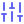

# &nbsp;Lab 02 — Smart Keyboard V1

> **Un moteur de suggestions de mots façon clavier de téléphone, construit avec un modèle de langage n-gramme, évalué par la perplexité et la précision top-3, et présenté dans une interface Streamlit claire/sombre.**


<p align="center">
  
</p>

---

## Sommaire

1. [Objectif du TP](#objectif)
2. [Données](#donnees)
3. [Concepts et formules](#concepts)
4. [Structure du projet](#structure)
5. [Installation et lancement](#installation)
6. [Ce qui a été réalisé](#realise)
7. [Analyse des échecs](#echecs)
8. [Tour de l'interface Streamlit](#interface)
9. [Réponses aux questions de réflexion](#reflexion)
10. [Limites, vie privée et éthique](#limites)
11. [Pistes d'extension](#extensions)

---

<a id="objectif"></a>
## &nbsp;1. Objectif du TP

Un **modèle de langage** attribue une probabilité au mot suivant, sachant ce qui a déjà été tapé :

$$P(\text{mot suivant} \mid \text{historique})$$

C'est l'idée la plus ancienne et la plus simple du NLP moderne, et c'est exactement la même quantité que les grands modèles neuronaux optimisent aujourd'hui.

**But final :** entraîner des modèles **unigramme, bigramme et trigramme**, les **lisser** pour qu'une séquence jamais vue n'obtienne pas une probabilité nulle, puis les comparer avec la **perplexité** et la **précision top-3** sur des documents mis de côté.

À l'issue du TP, on sait :

- calculer $P(w \mid \text{contexte})$ à partir de comptages et expliquer l'estimation du maximum de vraisemblance ;
- expliquer pourquoi un modèle non lissé échoue (probabilités nulles → perplexité infinie) et le corriger avec le **lissage add-k**, l'**interpolation** et le **back-off** ;
- calculer et interpréter la **perplexité** et la précision **top-k** ;
- séparer les données **par document** (et non par phrase) et expliquer la fuite que cela évite ;
- diagnostiquer les erreurs en listant les contextes jamais vus à l'entraînement.

### Pipeline

```
Corpus (60 documents)
      │
      ▼
Découpage PAR DOCUMENT (train / test)
      │
      ▼
Comptage des n-grammes (+ <s>, </s>, <unk>)
      │
      ▼
Lissage add-k · interpolation · back-off
      │
      ▼
Suggestions top-3 · perplexité · précision top-3
```

---

<a id="donnees"></a>
## &nbsp;2. Données

| Élément | Valeur |
|---|---|
| Corpus | 1 200 phrases synthétiques réparties en **60 documents** |
| Taille | ≈ 10 000 tokens, **61 types de mots** |
| Génération | Grammaire à graine fixe (`python data/make_data.py`) → tout le monde obtient les mêmes données |
| Format | `data/corpus.csv` avec les colonnes `doc_id` et `sentence` |
| Découpage | Les **20 % derniers documents** forment le test : **960 phrases d'entraînement / 240 de test** |
| Tokens | Train : 8 098 · Test : 2 070 |

> **Pourquoi découper par document et pas par phrase ?**
> Les phrases d'un même document partagent des mots thématiques. Mettre certaines en train et d'autres en test laisserait le modèle « voir » le vocabulaire du test et rendrait les scores meilleurs qu'ils ne le sont vraiment (**fuite de données**).

---

<a id="concepts"></a>
## &nbsp;3. Concepts et formules

### Symboles spéciaux

- `<s>` : début de phrase (ajouté $n-1$ fois pour un modèle d'ordre $n$) ;
- `</s>` : fin de phrase — le modèle doit aussi la **prédire** ;
- `<unk>` : mot inconnu. `clean()` y ramène tout mot hors vocabulaire pour que le modèle ne plante jamais.

### Trigramme avec lissage add-k

$$P(w \mid u\,v)=\frac{\text{count}(u\,v\,w)+k}{\text{count}(u\,v)+k\cdot V}$$

où $V$ est la taille du vocabulaire.

- $k = 0$ → un contexte inconnu donne une probabilité **0** : le modèle est fragile ;
- $k = 1$ → trop généreux : beaucoup de masse pour des séquences impossibles ;
- $k$ petit (≈ 0,01 à 0,1) → bon compromis.

### Perplexité

$$PP=\exp\left(-\frac{1}{N}\sum_{i=1}^{N}\log P(w_i \mid \text{contexte}_i)\right)$$

*Intuition : le modèle est aussi hésitant que s'il devait choisir uniformément parmi PP mots à chaque étape.* Plus c'est bas, mieux c'est. Un tirage uniforme sur ce vocabulaire donnerait environ **61**.

### Interpolation linéaire

$$P = \lambda_3 P_3 + \lambda_2 P_2 + \lambda_1 P_1 \qquad (\text{défaut : } 0{,}6 \;/\; 0{,}3 \;/\; 0{,}1)$$

### Back-off

On utilise le **plus grand n-gramme dont le contexte a déjà été vu** : trigramme → bigramme → unigramme.

### Précision top-k

Part des positions où le vrai mot suivant figure parmi les $k$ suggestions (ici $k=3$).

---

<a id="structure"></a>
## &nbsp;4. Structure du projet

```
02_smart_keyboard_v1/
├── app.py                  # Interface Streamlit (ce que nous avons réalisé)
├── requirements.txt        # matplotlib, streamlit
├── assets/
│   └── icons/              # icônes SVG utilisées par ce README
├── data/
│   ├── make_data.py        # génère corpus.csv (graine fixe)
│   └── corpus.csv
├── src/
│   ├── pipeline.py         # NGramModel, InterpolatedModel, split_by_document, top_k_accuracy…
│   └── evaluate.py         # évaluation complète, backoff_accuracy, balayage de k
└── results/
    ├── metrics.json
    ├── failures.txt
    └── ngram_results.png
```

> `app.py` **ne modifie aucun fichier du projet** : il utilise uniquement `src/pipeline.py` et `src/evaluate.py`.

---

<a id="installation"></a>
## &nbsp;5. Installation et lancement

```bash
# 1. se placer dans le dossier du lab
cd 02_smart_keyboard_v1

# 2. créer un environnement isolé (Python 3.10+)
python -m venv .venv
source .venv/bin/activate        # Windows : .venv\Scripts\activate

# 3. installer les paquets
pip install -r requirements.txt  # = matplotlib streamlit

# 4. générer le jeu de données (graine fixe)
python data/make_data.py

# 5. lancer l'évaluation complète (imprime tous les chiffres du rapport)
python -m src.evaluate

# 6. lancer l'application web
streamlit run app.py
```

---

<a id="realise"></a>
## &nbsp;6. Ce qui a été réalisé

### Partie A — Le moteur de langage (`src/pipeline.py`)

| Composant | Rôle |
|---|---|
| `split_by_document` | Découpage reproductible : les 20 % derniers documents = test |
| `NGramModel` | Comptage des n-grammes (`ctx_counts`, `ctx_totals`), `clean()`, `context()`, `prob()` avec add-k, `next_word_distribution()`, `top_k()`, `seen_context()`, `perplexity()` |
| `InterpolatedModel` | Mélange pondéré trigramme / bigramme / unigramme |
| `top_k_accuracy` | Précision top-k + liste des échecs |
| `backoff_accuracy` (`src/evaluate.py`) | Précision top-3 du back-off dur 3→2→1 |

### Partie B — L'évaluation (`python -m src.evaluate`)

- tableau comparatif des modèles (perplexité, part de tokens à probabilité 0, top-3) ;
- balayage du lissage $k$ pour le bigramme et le trigramme ;
- export de `results/metrics.json`, `results/failures.txt` et `results/ngram_results.png` ;
- repérage des contextes trigrammes jamais vus à l'entraînement.

### Partie C — L'application Streamlit (`app.py`)

- **Suggestions en direct** en tapant ou en cliquant sur un mot proposé, avec auto-complétion par préfixe ;
- **5 méthodes de prédiction** : back-off, trigramme, interpolé, bigramme, unigramme ;
- **Transparence** : explication des comptes réels et de la formule derrière chaque suggestion ;
- **Notation de phrase** : perplexité et « surprise » (en bits) mot par mot ;
- **Génération aléatoire** contrôlée par la température et la graine ;
- **Évaluation** : résultats du rapport + recalcul en direct avec les paramètres choisis ;
- **Robustesse** : un mot inconnu est signalé, traité comme `<unk>`, et l'application ne plante jamais ;
- **Design adaptatif** clair/sombre ;
- **Mises en cache** (`st.cache_data`, `st.cache_resource`) pour que les modèles ne soient entraînés qu'une fois par combinaison de paramètres.

---

<a id="echecs"></a>
## &nbsp;7. Analyse des échecs

| Type d'échec | Exemple | Explication |
|---|---|---|
| **Ambiguïté en début de phrase** | `the` → *foxes* | Après « the », presque n'importe quel nom est possible ; 3 suggestions ne couvrent pas ~20 noms |
| **Contexte jamais vu** | `lazy soup` | Combinaison que la grammaire n'a jamais produite à l'entraînement → il faut **reculer vers un ordre inférieur** (back-off) |
| **Choix sémantique** | `eat the` → *cakes* | Plusieurs aliments sont équiprobables ; un n-gramme n'a aucune notion de sens |

9 positions de test ont un contexte trigramme absent de l'entraînement (ex. `brave foxes`, `brave girls`, `happy bread`, `hungry key`, `lazy soup`).

**Correctif proposé :** utiliser le **back-off** ou l'**interpolation** plutôt qu'un trigramme pur. C'est précisément ce que l'onglet *Comparer* de l'application met en évidence.

---

<a id="interface"></a>
## &nbsp;8. Tour de l'interface Streamlit

### &nbsp;Barre latérale

| Contrôle | Effet |
|---|---|
| **Méthode de prédiction** | Back-off 3→2→1 (par défaut), Trigramme, Interpolé 3/2/1, Bigramme, Unigramme |
| **Lissage k** | 0,001 · 0,01 · 0,1 (par défaut) · 0,5 · 1,0 |
| **Nombre de suggestions** | De 1 à 6 (3 par défaut) |
| **Utiliser tout le corpus** | Inclut le test dans l'entraînement (fuite) → l'évaluation en direct est désactivée |
| **Poids de l'interpolation** | λ₃ (0,6), λ₂ (0,3) ; λ₁ = 1 − λ₃ − λ₂ est calculé automatiquement |

### &nbsp;En-tête et indicateurs

Quatre cartes résument l'état courant : **Vocabulaire V**, **Phrases train**, **Méthode** et **Lissage k**.

---

### &nbsp;Onglet « Clavier »

Le cœur de l'application. On tape un début de phrase (ou on clique sur une suggestion) et le modèle propose les mots suivants.

- champ de saisie initialisé avec `the happy girls` ;
- case **« Je suis en train d'écrire un mot »** : active l'auto-complétion par préfixe, comme sur un vrai clavier ;
- bouton **Effacer** ;
- **boutons de suggestion** affichant le mot et sa probabilité ; le survol donne la valeur exacte `P = …` ;
- le badge indique le **modèle réellement utilisé** (ex. `3-gram`, ou `2-gram` en cas de repli) ;
- **histogramme** des 10 mots les plus probables ;
- encart **« Pourquoi ces suggestions ? »** : comptes réels $n(c,w)$ et $n(c)$, formule avec les valeurs numériques, tableau des probabilités ;
- **avertissements utiles** : mots hors vocabulaire, contexte jamais vu, préfixe sans correspondance, repli du back-off.

<p align="center">
  
</p>

---

### &nbsp;Onglet « Comparer »

Un tableau qui met côte à côte les **5 méthodes** pour le texte courant : modèle réellement utilisé, contexte vu ou non à l'entraînement, et top-3 avec probabilités. On y voit qu'un trigramme sur un contexte inconnu donne des suggestions arbitraires, ce que le back-off corrige.

<p align="center">
  
</p>

---

### &nbsp;Onglet « Phrase »

On saisit une phrase complète (terminée par `.` pour inclure la fin de phrase) et l'application calcule :

- la **perplexité de la phrase** ;
- un graphique de la **surprise par mot** (en bits, $-\log_2 p$) ;
- un tableau détaillé : position, mot, probabilité, surprise, mot inconnu ;
- le **mot le plus surprenant**.

---

### &nbsp;Onglet « Générer »

Génération aléatoire de phrases à partir du modèle choisi :

- **Température** (0,2 à 2,0) : < 1 prudent, > 1 plus aléatoire ;
- **Nombre de phrases** (1 à 10) ;
- **Graine aléatoire** pour des résultats reproductibles.

<p align="center">
  
</p>

---

### &nbsp;Onglet « Évaluation »

**Résultats du rapport** : tableau issu de `results/metrics.json` (perplexité, part de tokens à p = 0, top-3) et figure `ngram_results.png` (perplexité selon k, qualité des suggestions).

<p align="center">
  
</p>

**Analyse d'échecs** (`results/failures.txt`) et **évaluation en direct** : le bouton *Calculer maintenant* recalcule perplexité et top-3 avec les paramètres actuels (k, λ). Elle est désactivée quand « tout le corpus » est coché, pour éviter la fuite.

<p align="center">
  
</p>

---

### &nbsp;Onglet « À propos »

Résumé du jeu de données, de la méthode d'évaluation honnête (découpage par document), des limites des n-grammes, de la vie privée, et rappel des paramètres actuels (V, k, λ, méthode, corpus utilisé).

---

<a id="reflexion"></a>
## &nbsp;9. Réponses aux questions de réflexion

1. **Pourquoi la perplexité se dégrade entre bigramme (k=1) et trigramme (k=1), mais s'améliore avec k=0,1 ?**
   Un trigramme a beaucoup plus de contextes, chacun vu rarement. Avec k=1, la masse réservée $k\cdot V$ est énorme par rapport à de petits comptes $n(c)$ et dilue les bonnes prédictions. Avec k=0,1, cette masse gaspillée diminue et le trigramme tire parti de son contexte plus riche.
2. **Un 5-gramme aiderait-il sur 960 phrases ?**
   Probablement non : plus l'ordre augmente, plus les contextes sont rares (**dispersion des données**). La plupart des contextes de test ne seraient jamais vus et il faudrait reculer vers des ordres inférieurs.
3. **Pourquoi la perplexité n'est-elle pas comparable entre un modèle de mots et un modèle de caractères ?**
   Elle est calculée *par token* : prédire un caractère parmi un petit alphabet et prédire un mot parmi des milliers n'ont pas la même échelle ni la même unité.
4. **Comment utiliser l'application sans envoyer le texte à un serveur ?**
   En exécutant tout **en local** : les modèles sont entraînés sur la machine, rien n'est envoyé ni enregistré. C'est le cas ici.

---

<a id="limites"></a>
## &nbsp;10. Limites, vie privée et éthique

- **Données synthétiques et grammaticales par construction** : le texte réel est bien plus difficile (des perplexités de 100 et plus sont normales).
- **Aucun sens** : un n-gramme ne comprend pas la sémantique (« eat the » → plusieurs aliments équiprobables) et ne voit que $n-1$ mots de contexte.
- **Vie privée** : tout tourne en local, le texte tapé n'est ni envoyé ni enregistré. Un clavier entraîné sur des messages personnels doit rester sur l'appareil.
- **Pièges à éviter** : comparer des perplexités avec des vocabulaires différents, laisser des mots de test entrer dans le vocabulaire (fuite), oublier `</s>` dans les probabilités.

---

<a id="extensions"></a>
## &nbsp;11. Pistes d'extension

- Lissage de **Kneser-Ney**.
- Entraînement sur **son propre texte** (un export WhatsApp est une donnée personnelle : uniquement avec son consentement et sans jamais le partager).
- Jeu de **validation séparé** pour régler k et les λ, puis un unique passage sur le test.
- Optimisation des poids d'interpolation par validation.
- Passage vers un modèle neuronal (voir le Lab 07).

---

<p align="center"><sub>Lab 02 · Smart Keyboard V1 · n-grammes + add-k + back-off + interpolation</sub></p>